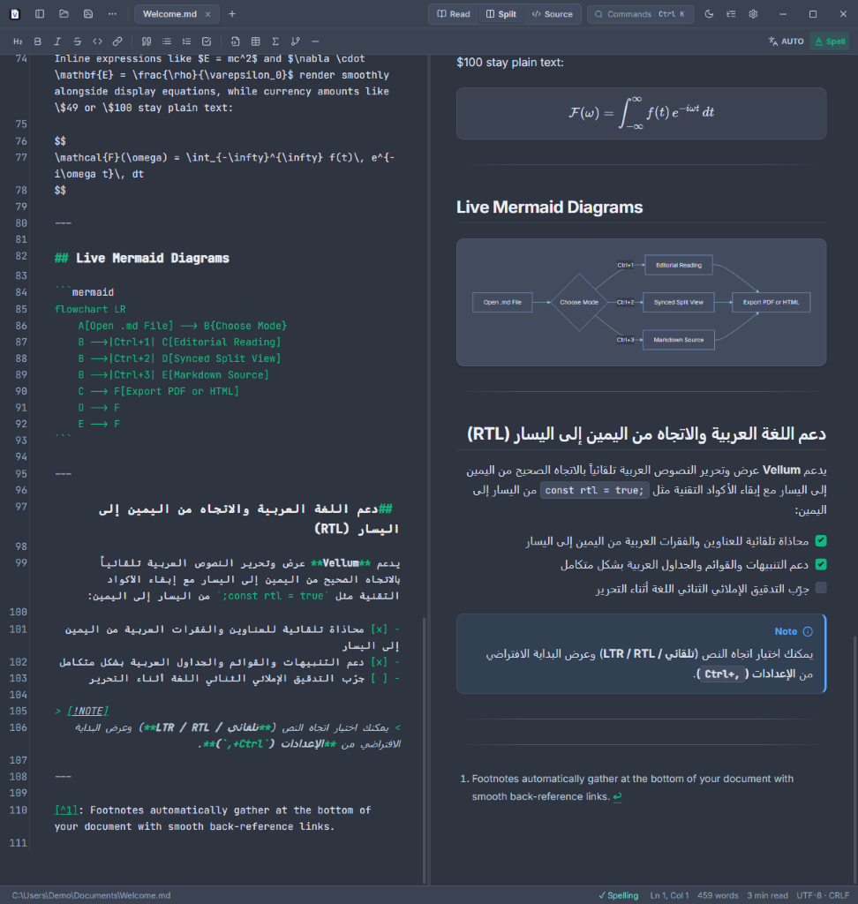
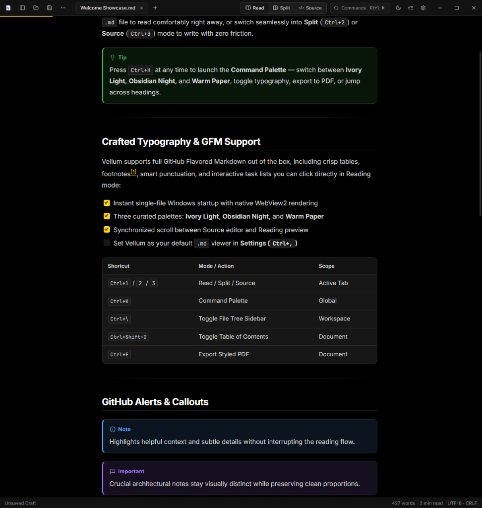
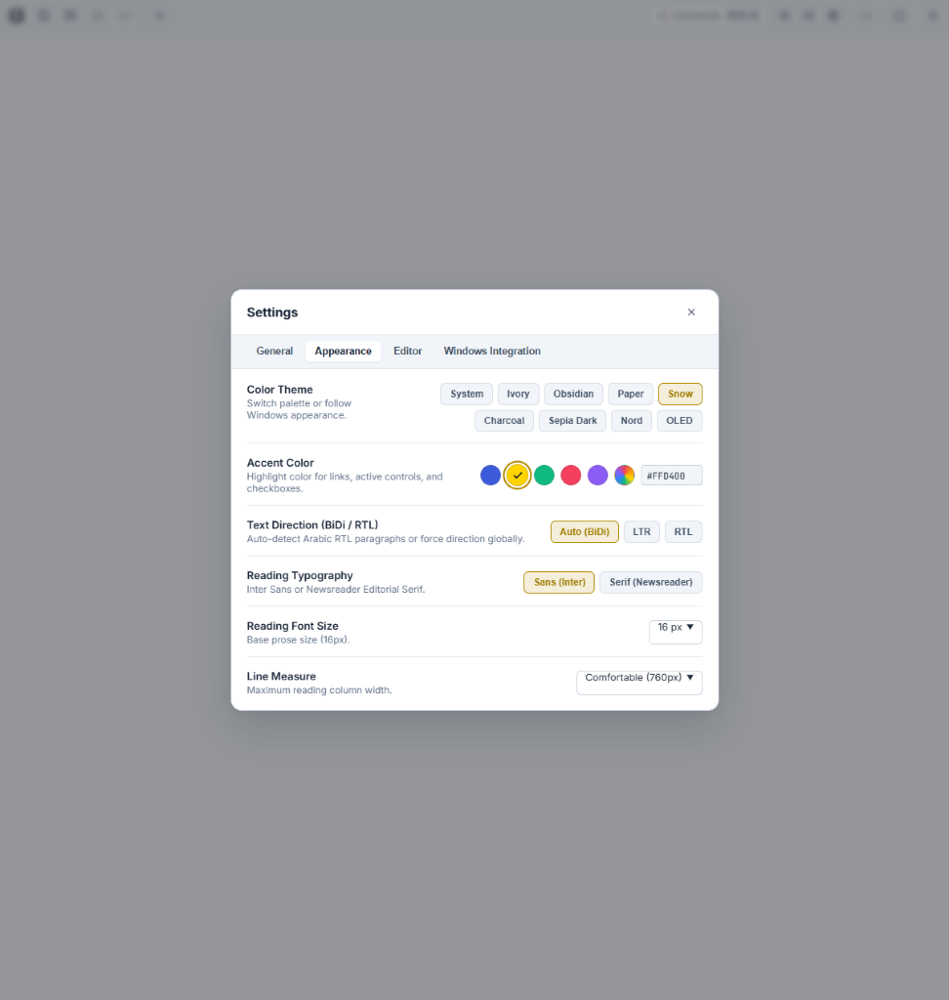

# Vellum

> A fast, lightweight, editorial-grade Markdown viewer and editor for Windows.

Vellum opens instantaneously in a refined reading view and lets you switch effortlessly between **Read**, **Split**, and **Source** modes. Built with **.NET 8 (WPF) + Edge WebView2 + TypeScript**, it avoids bundling Chromium, resulting in a tiny single-file executable (~8.4 MB) with native Windows integration.



---

## Features

- **8 Curated Themes + System Sync** — Switch between **Ivory Light**, **Obsidian Night**, **Warm Paper**, **Snow**, **Charcoal**, **Sepia Dark**, **Nord**, and **OLED**, or follow Windows appearance automatically (**System**).
- **Custom Accent Colors** — Choose **Default Blue**, **Gold (`#FFD400`)**, **Emerald**, **Rose**, **Violet**, or pick any custom hex color for links, active controls, blockquotes, selection, and task checkboxes — with automatic contrast safeguards in light themes.
- **Three Modes (`Ctrl+1` / `2` / `3`)** — Clean Reading mode, synchronized Split preview, and distraction-free CodeMirror 6 Markdown Source editor with formatting toolbar.
- **Rich Markdown Support** — GitHub Flavored Markdown tables, interactive clickable task lists, footnotes, YAML frontmatter bar, all 5 GitHub Alerts (`NOTE`, `TIP`, `IMPORTANT`, `WARNING`, `CAUTION`), syntax-highlighted code blocks with copy button, inline & display **KaTeX** math, and **Mermaid** diagrams.
- **Arabic / RTL & Bilingual Spell Check** — Automatic per-paragraph BiDi/RTL layout (while keeping code/math LTR), global `Auto / LTR / RTL` toggle, and Windows-native English & Arabic spell checking with non-blocking 1-click suggestions (`F7`).
- **Workspace & Configurable Startup** — Multi-tab strip, collapsible file tree sidebar, live scroll-spy Table of Contents outline, in-page Find & Replace, `Ctrl+K` Command Palette, and selectable startup view (`Welcome`, `Restore Last Session`, `Blank Document`, or `Showcase Guide`).
- **Native Windows Integration** — Frameless Aero Snap window, single-instance multi-tab launching, drag-and-drop file opening, automatic live reload on external edits, and zero-admin `.md` file association.
- **Export Anywhere** — Styled PDF export (`Ctrl+E`) preserving vector diagrams and equations, plus standalone self-contained HTML export.

---

## Screenshots

### OLED + Gold Accent (`#FFD400`) Reading View


### Appearance Settings — Themes & Accent Color Picker


---

## Download

Grab the latest pre-built Windows executable from [GitHub Releases](https://github.com/abualnassr/vellum/releases):

- **`Vellum-win-x64-lightweight.zip`** — Tiny single-file `.exe` (~8.4 MB; requires .NET 8 Desktop Runtime, pre-installed on most Windows 11 PCs)
- **`Vellum-win-x64-standalone.zip`** — Self-contained `.exe` with zero runtime prerequisites

---

## Keyboard Shortcuts

| Shortcut | Action |
|---|---|
| `Ctrl+1` / `Ctrl+2` / `Ctrl+3` | Switch to Read / Split / Source mode |
| `Ctrl+K` | Open Command Palette |
| `Ctrl+O` / `Ctrl+N` | Open File / New Document |
| `Ctrl+S` / `Ctrl+Shift+S` | Save / Save As |
| `Ctrl+W` / `Ctrl+Tab` | Close Tab / Next Tab |
| `Ctrl+F` / `Ctrl+H` | Find / Replace |
| `F7` | Jump to next spelling suggestion |
| `Ctrl+\` / `Ctrl+Shift+O` | Toggle File Sidebar / Outline |
| `Ctrl+=` / `Ctrl+-` / `Ctrl+0` | Zoom In / Zoom Out / Reset Zoom |
| `Ctrl+E` | Export to PDF |
| `Ctrl+,` | Open Settings |

---

## Building from Source

### Prerequisites

- **Windows 10 / 11** (with Edge WebView2 Runtime — pre-installed on Windows 11 and modern Windows 10)
- **Node.js 20+**
- **.NET 8 SDK**

### Build Single-File Executable

```powershell
# 1. Install frontend packages
cd ui
npm install
cd ..

# 2. Generate icon, build UI, and publish lightweight single-file dist\Vellum.exe
.\scripts\build.ps1
```

To build a fully self-contained executable that requires no `.NET 8 Desktop Runtime` on the target machine:

```powershell
.\scripts\build.ps1 -SelfContained
```

### Run Tests

```powershell
# Frontend unit tests & typecheck
cd ui
npm run typecheck
npm test
cd ..

# Backend C# unit tests
dotnet test tests/Vellum.Tests/Vellum.Tests.csproj
```

---

## Setting as Default `.md` Viewer

Open **Settings (`Ctrl+,`) -> Windows Integration -> Register .md Files**, then click **Default Apps** and choose **Vellum** for `.md`.

---

## License

[MIT](LICENSE)
